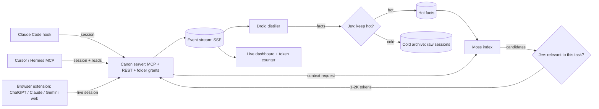

# Canon PRD

**Cal Hacks 13.0 · team of 3 · submit by Sun 10/25 9:00 AM PDT · judging 10:30–12:30**

> One place that keeps your context from every AI session, live, and gives each new chat
> only what it needs.

## 1. The idea

Canon is one platform that keeps your context from every AI session you use: Claude, ChatGPT
and Gemini on the web, plus Claude Code, Cursor and Hermes. It captures that context **live and
automatically**, so there's never a manual export or import.

Whenever you open a new chat or coding session anywhere, it can draw on what you did in any
other AI. **Jev** decides which information is relevant enough to keep, and the session gets
only that small slice, quickly and cheaply. It doesn't start from zero, and it doesn't load a
huge context dump before your first message.

You organize knowledge into **folders**, such as career, projects and private. You decide
which AI sees which folder.

Example use case: work you did in Claude Code shows up automatically when ChatGPT helps update
your resume for a job application.

Canon starts as a tool for one person or a small team, and the demo shows how it grows into a
company version with shared team knowledge, permissions and governance. This follows the usual
SaaS path: a free personal tier first, then a custom setup for companies.

## 2. Problem

**Who it's for:** Berkeley students recruiting for internships whose best work happens
inside AI sessions.

You ship something real in Claude Code at 2 AM. Two weeks later you apply for a job in ChatGPT,
and it has no idea that work happened. Your context is split across five AIs that don't talk to
each other. Moving it today means one of three bad options:

- **Re-explain everything by hand** in each new chat.
- **Run a one-time import.** Claude's memory import works by pasting a prompt, and Anthropic
  labels it experimental. It goes stale the next day.
- **Dump everything into context.** Exports, long project files and pasted histories cost
  tokens and slow the first reply before you've typed anything, and the useful part gets buried.

Teams have the same problem at larger scale. Decisions and "how we deploy" live in one
person's chat history, and every new agent or new hire has to be told again.

Anthropic's track wants a named community and a problem the team has lived. Victor lives this
one. Edan collects raw notes from five student interviews at the venue, and Victor picks the
quotes for the pitch.

## 3. Competitors and moat

| Product | What it does today | Where Canon differs |
|---|---|---|
| Supermemory | Hosted MCP server for Claude Code, Cursor and Gemini CLI. Its browser extension suggests saved memories in the Claude and Gemini web composers. | We found no relevance threshold or token budget per request. The extension suggests memories rather than capturing whole sessions. |
| Mem0 OpenMemory | Local-first MCP memory shared between Cursor and Claude. A hosted version exists. | Centered on coding tools. It doesn't capture live from AIs on the web. |
| Claude memory import | A one-time paste from other assistants. Labeled experimental. | Manual and one-off. Canon captures continuously. |
| Built-in memory (ChatGPT, Claude, Gemini) | Memory inside one vendor. | Locked to one vendor. |
| Obsidian + MCP, Basic Memory | Markdown notes that agents can read and write. | Curated by hand, and every agent sees everything. |
| MemoryLake, Conxt | Cross-AI memory startups. | They compete on storage. Canon competes on handing over the right context, cheaply. |

**The moat:**

1. **All in one, live.** Every session is captured as it happens: Claude Code and Cursor
   through hooks and MCP, ChatGPT, Claude and Gemini on the web through the extension. Nothing
   to export or import.
2. **Jev keeps only what matters.** When something is saved, Jev decides what's worth keeping
   "hot". When a session asks, Jev filters candidates so only the relevant ones get through. Raw
   sessions stay in a cold archive, so nothing is lost.
3. **Lean context.** A new session gets about 1–2K relevant tokens instead of a huge dump. The
   dashboard shows tokens, latency and cost for every handoff.
4. **Folders.** You decide which AI sees what. This is also the basis of the team and company
   versions.

Measured claim for the pitch: *"Pasting your full history: ~180K tokens. Canon: ~1.4K tokens.
Same answer."* The benchmark (section 7) produces the real numbers. We only compare against
baselines we actually run.

## 4. Demo script (2 minutes, live; the video opens with step 4)

1. **0:00 Work in Claude Code.** We merge a PR in Canon's own repo. The capture hook sends the
   session to Canon automatically.
2. **0:15 Chat on ChatGPT's website.** Talk through which internships you're targeting. The
   extension captures it live.
3. **0:30 The live dashboard updates.** Both sessions appear. The Droid distiller turns them
   into facts and files each in a folder, and Jev marks each fact hot or cold.
4. **0:50 Open a new ChatGPT chat.** Say "update my resume for this job" and paste the posting.
   Canon hands over only the relevant facts. The counter shows **1.4K tokens against 180K**. The
   resume includes the Claude Code work.
5. **1:20 Go the other direction.** A new Cursor session asks "what did I decide in ChatGPT
   about which roles to target?" It gets the answer in under a second.
6. **1:40 Folders and scale.** A teammate's Cursor can read `team/` but is refused `private/`.
   Close on the benchmark chart and the company-version slide.

## 5. Track map

A project can enter several tracks (at Cal Hacks 12.0 one project won three prizes). Every
integration has to do real work in the product.

| Tier | Track | Prize | Why Canon qualifies | Must show / submit |
|---|---|---|---|---|
| Core | Anthropic | $5k Claude credits + 1 yr Max 20x | Named community and a lived problem. Claude turns sessions into facts and writes the resume. Its failure modes (leaking a private folder, handing over stale context) are guarded by folders and Jev's freshness checks. | Who it's for, an interview quote, and the private-folder refusal on screen |
| Core | Factory Droid SDK | $2,000 | Droid is the distiller. It runs on our trigger (each captured session, plus a nightly cleanup), can only write to the fact store, and its plan and fact diffs show on the dashboard. | README "Where Droid runs", diff view in the demo |
| Core | Moss | AirPods Max / Pro | Matches Moss's "Personal Agent" category. Moss is the retrieval layer, and Jev filters what it returns. | Retrieval latency on the dashboard |
| Core | Microsoft: Built for the Real World (+ Customer Impact) | Surface per member | A production-minded productivity agent with measured results (tokens, cost, accuracy) and a path from personal to company. | Benchmark chart, scale slide |
| Add | Cal Hacks general | Overall, Most Technically Complex, Hacker's Choice | Every project competes for these. | — |
| Add | MLH: Gemini API, GoDaddy domain | Swag | Gemini CLI is a captured client, and we register a domain. | Low effort |
| If time | SpacetimeDB | $2,048 / $1,024 / $512 | Its brief names "instant sync between users/agents/systems". The demo ships on SSE first. | Confirm it's selectable on Devpost |
| If time | Apify | $2k / $1k / $800 / $400 / $400 + $400 Best Actor | An Actor that turns a job posting into a requirements list for the resume step. | A published Actor |
| If time | Armadin Best Security Hack | $996 + Apple headphones | Folder permissions per AI, plus quarantining facts planted through prompt injection. | Criteria not published yet |
| Skip | Hyphenate, CRS, Visa, Nessie, Coinbase, Fetch.ai, Cartesia, Meta, Atlassian, Elastic, Figma | — | Wrong domain, or the track needs a different product. Elastic duplicates Moss. | Choosing Canon gives up Hyphenate's $16k pool |

## 6. Scope

**Must ship**
- Fact store with folders and hot/cold tiers, plus a cold archive for raw sessions
- Remote MCP server: `canon_context`, `canon_search`, `canon_save`, `canon_whoami`
- An access token per AI client, mapped to its folders
- Claude Code capture hook
- Browser extension capturing ChatGPT web sessions
- Droid distiller: session in, facts out
- Jev decisions on save and on retrieve (Claude fallback behind the same interface)
- Moss index over hot facts
- ChatGPT web reading through its MCP connector
- Live dashboard with a token, latency and cost counter
- Resume built from facts, with each line linking to its source session
- Benchmark: 20 handoff tasks, 3 baselines

**Stretch (in order)**
1. Capture from Claude and Gemini on the web (same extension)
2. Team mode with a second user and a `team/` folder
3. Apify job-posting Actor
4. Nightly cleanup that demotes stale facts
5. Quarantine for facts planted through prompt injection
6. SpacetimeDB for the event stream

**Out of scope:** our own chat UI, SSO and billing (scale slide only), LinkedIn scraping, a
mobile app.

## 7. Architecture

Interface contracts (fact file, MCP tools, client grants, Jev questions and thresholds) live
in `CLAUDE.md` so both builders work against the same definitions.

**Benchmark.** 20 tasks that hand context from one AI to another, each with an answer key (for
example: "which roles did I decide to target?", "what did I ship this week?"). Each task runs
three ways: no memory, paste the full history, and Canon. We record accuracy, tokens injected,
cost and time to first reply, then chart accuracy against tokens.

**About Jev.** TypeSafe AI's "semantic decision engine" (released Sep 15, 2026, early access).
It's a hosted model, `jev-latest`, that answers typed questions (Choice, Score, Noul for yes/no)
with probabilities. It costs $0.042 per million input tokens, output is free, and responses take
70–500 ms. It isn't a Cal Hacks sponsor, so it adds technical depth but no prize eligibility.

## 8. Scale story

| Tier | What it is |
|---|---|
| Personal | One store and one server. Folders for career, projects and private. This is what we demo. |
| Small team | A `team/` folder for everyone, a private folder per member, and per-AI access. Shown in demo step 6. |
| Company | SSO and user provisioning, org-wide access rules per agent, retention and audit, and sources such as Jira, Confluence and Slack. A forward-deployed engineer sets it up. |

## 9. Build plan

Two builders and one ops/QA owner. Task-level tracking lives in `status/status.json` (see
`STATUS.md`). Sync rhythm and sleep rotation are in `CLAUDE.md`.

| Owner | Owns |
|---|---|
| A · Henry Lai: server & retrieval | Fact store and cold archive, MCP server, folder grants, Moss, the Jev filter in `canon_context`, benchmark runner, SSE event stream |
| B · Victor Chun: capture, distill, UI & story | Claude Code hook, extension (ChatGPT web), Droid distiller, Jev save-time decisions, ChatGPT connector, dashboard with the token counter, resume viewer. Also the story: Devpost text, pitch, video script and voiceover, scale slide, sponsor README sections |
| C · Edan Wong: ops & QA | Sponsor answers, workshops, accounts and keys, Devpost logistics, raw interview notes, demo test sessions, benchmark task set, QA after every sync, screen recording, rehearsal timing, timekeeping |

| Window | Done means |
|---|---|
| Fri 20:00–24:00 | Scope locked, fact schema frozen, Claude Code can call `canon_save` and `canon_context` on local files, Jev access requested, sponsor questions asked |
| Sat 00:00–09:00 | Rotate sleep. Moss index running, Droid distiller v0, dashboard showing live events |
| Sat 09:00–18:00 | Extension capturing ChatGPT web, connector reading, Jev on save and retrieve, grants enforced, resume flow working |
| Sat 18:00–24:00 | Benchmark run and chart, team mode if on schedule, **Devpost draft before midnight**, first video cut |
| Sun 00:00–07:00 | Polish, fallback demo recording, sponsor README sections |
| Sun 07:00–09:00 | **Code freeze 07:00**, final video, submit by 08:30, rehearse |

## 10. Risks

| Risk | Mitigation |
|---|---|
| Only two people are building, and Victor also owns the story | Stretch stays stretch. Cut order: Apify → team mode → Gemini web → SpacetimeDB. Edan takes all ops, logistics, recording and QA off the builders' plates. Victor blocks Sat 19:00–21:00 for Devpost text and the video script. |
| Jev early access doesn't come through | Claude fallback behind the same `judge()` interface |
| ChatGPT can't write over MCP on Plus | Capture through the extension. ChatGPT only reads. |
| Chat sites change their page structure and break the extension | Build and test ChatGPT capture first. Claude Code capture is the guaranteed demo path. |
| The Droid SDK can't run headless | Ask at the Factory booth Friday night. Fallback is a Claude agent loop, which drops the Factory track. |
| Judges say "this is just Supermemory" | Lead with live capture across web and code, then the token counter and benchmark chart |
| Venue Wi-Fi fails | Local server plus a recorded run of the full demo |

## 11. Sources

- Supermemory MCP docs: https://supermemory.ai/docs/supermemory-mcp/introduction
- Supermemory extension changelog: https://supermemory.ai/changelog/browser-extension-support-for-claude-and-gemini.md
- Mem0 OpenMemory: https://mem0.ai/blog/introducing-openmemory-mcp
- OpenAI developer mode and MCP: https://help.openai.com/en/articles/12584461-developer-mode-apps-and-full-mcp-connectors-in-chatgpt-beta
- Jev explained: https://www.dailydoseofds.com/p/jev-clearly-explained/
- Moss: https://www.ycombinator.com/companies/moss
- Cal Hacks 13.0 Devpost: https://cal-hacks-13-0.devpost.com/
